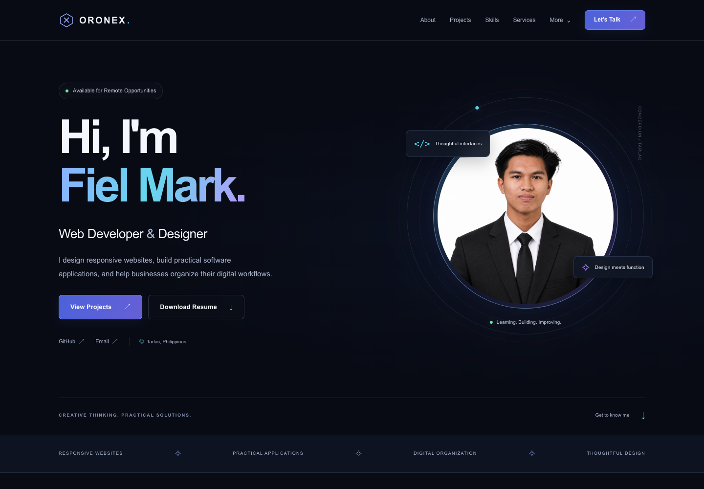
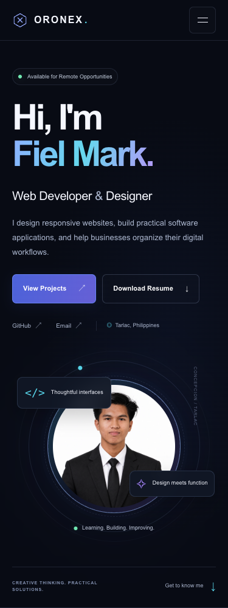

# ORONEX — Fiel Mark E. Oronos

Personal portfolio for web development, design, and digital support. Built with HTML, CSS, and vanilla JavaScript; no framework, production dependencies, or build step.

[Live portfolio](https://oronex-dev.github.io/portfolio-fiel-mark/) · [GitHub](https://github.com/oronex-dev)

## Preview




## Local preview

From this repository:

```sh
python3 -m http.server 4173 --bind 127.0.0.1
```

Open [the local website](http://127.0.0.1:4173/). To test the GitHub Pages subpath, run the server from the repository's parent directory and open `/portfolio-fiel-mark/`.

## Content and assets

- `index.html`: semantic sections and pre-rendered project/certificate cards.
- `style.css`: responsive design tokens, components, and reduced-motion styles.
- `script.js`: navigation, filters, document viewer, motion, and contact behavior.
- `config.js`: public Formspree endpoint used by the contact form. It contains no private credentials.
- `assets/projects.json`, `assets/certificates.json`: source records for the galleries.
- `assets/images/projects/twogethera-*`: Twogethera application icon, labeled mobile design preview, and supplied app capture used in its Selected Work card.
- `tools/render_content.py`: regenerate gallery HTML after changing its source records.
- `tools/verify_site.cjs`: browser regression checks, responsive screenshots, and accessibility scans.

After editing the gallery JSON:

```sh
python3 tools/render_content.py
```

Optional formatting: `npx prettier@3.6.2 --write index.html style.css script.js config.js assets/*.json tools/verify_site.cjs`.

## Contact and documents

The contact form posts to the configured Formspree endpoint and reports success only after an explicit provider acceptance response. Browser tests intercept submissions; no live message or Gmail delivery has been verified. Confirm the intended recipient in Formspree and run an owner-approved live test before claiming delivery.

The approved Web Developer and Administrative Support resumes use matching preview/download cards. Selected Work keeps four project cards and now showcases Twogethera in place of the ORONEX portfolio card. Certificates use actual supplied PDFs and rendered page previews. Verification links come directly from the evidence; the website does not claim independent issuer verification. The hero includes the owner-supplied LinkedIn profile.

Confidential business spreadsheets are unpublished. Never add their source URLs or business records to public assets.

## Hosting

All local asset references are relative and support the GitHub Pages project subpath. This change was prepared locally; it does not publish itself. Preserve the repository's configured Pages branch/directory when deploying after owner authorization.

The Jekyll configuration excludes the local audit documentation, QA scripts, and gallery source JSON from the published site output.

**Email:** [oronosfielmark@gmail.com](mailto:oronosfielmark@gmail.com)
