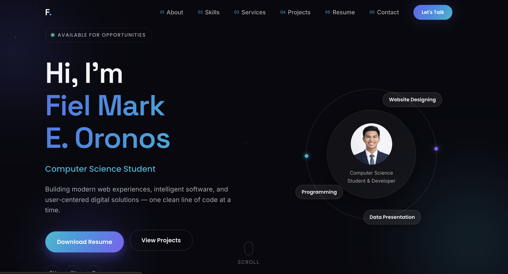
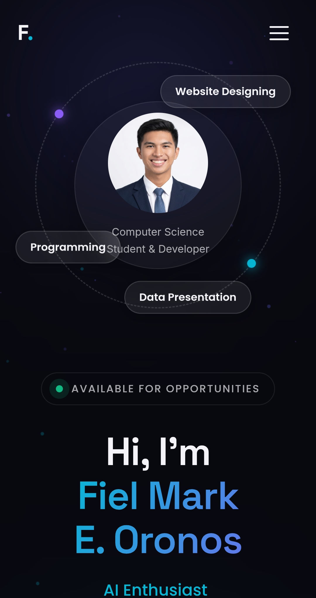

# Fiel Mark E. Oronos — Developer Portfolio

**Personal website · Web development · UI design · Digital operations**

My personal portfolio website introduces my professional background, technical skills, selected projects, and ways to contact me. It is intended for prospective employers, freelance clients, and collaborators.

**[View the live portfolio](https://oronex-dev.github.io/portfolio-fiel-mark/)** · **[GitHub profile](https://github.com/oronex-dev)**

## Website preview

<!-- Save actual screenshots of your website to the following paths. -->

### Desktop

### Mobile

## About this project

The site currently presents personal information, skills, services, project highlights, resume information, and a contact section. It uses a dark visual theme and responsive page layouts.

**Core web technologies:** HTML · CSS · JavaScript

## Website sections

- **About:** background, interests, and development journey.
- **Skills:** programming, frontend, backend, and design capabilities.
- **Services:** website development, responsive layouts, and UI-oriented work.
- **Projects:** selected academic, personal, and professional projects.
- **Resume:** education, technical experience, and professional information.
- **Contact:** channels for potential collaborators or employers.

## Local preview

For a standard static website, open its entry HTML file in a browser or serve it with a local static server. Confirm the repository's actual file structure before adding a specific run command here.

## Maintenance priorities

- Replace placeholder project entries with real case studies and verified screenshots.
- Ensure all links, live demos, downloadable resume files, and contact actions work.
- Review the mobile experience and keyboard navigation.
- Publish only genuine certifications and testimonials.
- Keep the visible portfolio content consistent with the current resume.

## Contact

- **GitHub:** [@oronex-dev](https://github.com/oronex-dev)
- **Email:** [oronosfielmark@gmail.com](mailto:oronosfielmark@gmail.com)

---

*Built as an evolving portfolio, with an emphasis on useful interfaces and verifiable project work.*
